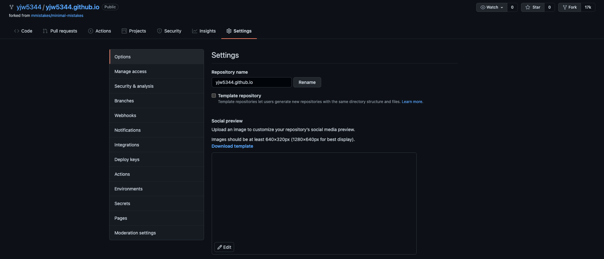

 

# minimal-mistakes 테마 사용하기

- [minimal-mistakes Theme 공식 페이지](https://mmistakes.github.io/minimal-mistakes/)

- [minimal-mistakes 가이드](https://mmistakes.github.io/minimal-mistakes/docs/quick-start-guide/)

- [minimal-mistakes github](https://github.com/mmistakes/minimal-mistakes)

minimal-mistakes 테마를 이용하여, jekyll 구성을 하기 위해서는 minimal-mistakes의 github repo로 접속합니다.

해당 테마를 fork 하여 자신의 Repository로 가지고 옵니다.

 

# Github-Blog Repository 설정

(본인의 Github ID).github.io 형식으로 Repository 이름을 변경합니다.

Push 후 (본인의 github ID).github.io로 접속하면 해당 테마로 Github Blog가 적용된 걸 확인할 수 있습니다.

__Repository -> setting -> Options -> Repository name 변경__

 

# jekyll을 이용한 로컬 서버 실행

~~~
$ cd (path) # jekyll 블로그(fork한 테마) 폴더로 이동
$ jekyll serve # jekyll 실행
~~~

실행되는 결과로 나오는 URL( ex.http://127.0.0.1:4000)을 통해서 확인이 가능합니다.

Jekyll Blog의 설정인 _config.yml 파일은 바로 반영이 불가하지만, 이외의 posting은 바로바로 반영되어 확인이 가능합니다.

 