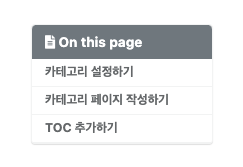

<br/>

# 카테고리 설정하기

`minimal-mistake/_data/navigation.yml` 에서 메뉴 설정이 가능합니다.

```json
# main links
main:
  - title: "Posts"
    url: "/categories/"
  - title: "Tags"
    url: "/tags/"
```

title은 메인 화면에 보여지는 영역이며, title의 값이 그대로 메뉴에 보여지게 됩니다.
url은 \_pages 폴더 내의 특정 페이지로 링크가 됩니다.

\_pages 폴더 내의 작성한 특정 페이지로 링크하기 위해서는 permalink로 연결해야됩니다.

# 카테고리 페이지 작성하기

`minimal-mistake/_pages/원하는 markdown 파일`로 특정 페이지를 작성합니다.

예) category-archive.md

```json
---
title: "Post by Categories"
layout: categories
permalink: /categories/
author_profile: true
---
```

`navigation.yml` 파일에서 설정한 url은 `_pages` 경로의 특정 markdown 파일의 permalink와 링크됩니다.

예를 들어, `navigation.yml`의 `url : "/categories/"`는 `_pages` 경로의 `category-archive.md`의 `permalink : /categories/`로 링크됩니다.

`navigation.yml`의 `url : "/categories/"`은 메인화면에서 Posts라는 메뉴로 표시되며, Posts 메뉴를 클릭 시 permalink에 따라 `category-archive.md` 페이지로 링크된다고 생각하면 됩니다.

즉, Posts 메뉴를 클릭하면 `category-archive.md` 파일로 연결되어, category-archive.md 파일의 title인 `"Post by Categories"`가 표출되는 것을 확인할 수 있습니다.

`category-archive.md`에 작성된 내용이 표출된 내용이 표시되며, `layout: categories`에 따라 작성한 posts 글의 `categories` 기준으로 필터되어 posting 된 글을 확인할 수 있습니다.

# TOC 추가하기

toc는 Table Of Contents의 약어로 포스팅 된 글의 우측에 적힌 목차입니다.



모든 포스팅 글에 TOC를 사용하는 것은 필수가 아니므로, 필요에 따라 작성하는 포스팅의 설정에 추가하여 사용하면 됩니다.

~~~json
# 포스팅 설정
---
title: "[Jekyll] Blog 시작하기(4)" # 포스팅 제목
excerpt: 카테고리 설정 # 포스팅 요약
author_profile: true # 포스팅 저자
toc: true # 포스팅 목차 표시
categories: # 포스팅 카테고리 
  - Jekyll
tags: # 포스팅 태그
  - Jekyll
  - Blog
---
~~~