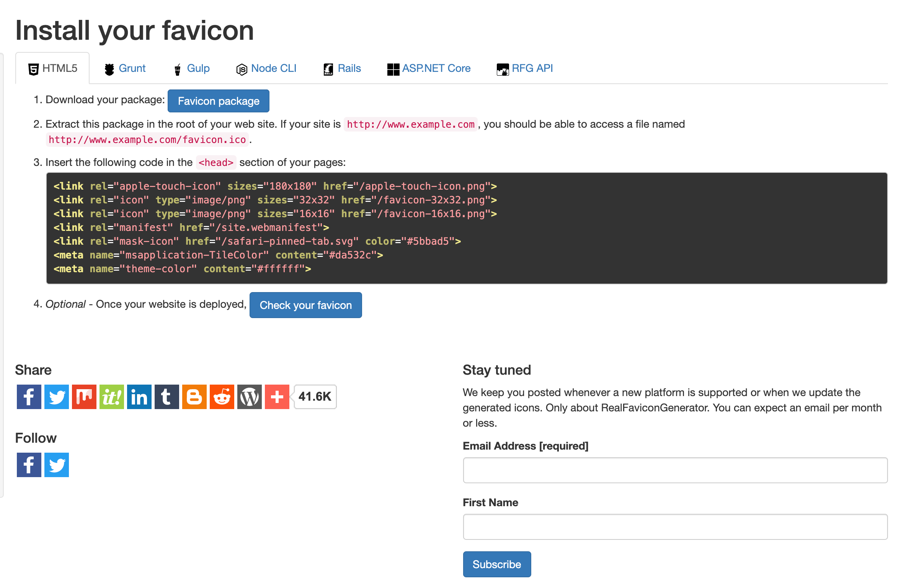

 

# 본문 너비 설정

`minimal-mistake/_sass/minimal-mistakes/_variables.scss` 에서 너비 설정이 가능합니다.

~~~scss
/*
   Grid
   ========================================================================== */

$right-sidebar-width-narrow: 150px !default;
$right-sidebar-width: 200px !default;
$right-sidebar-width-wide: 250px !default;
~~~

`_variables.scss` 파일에서 양쪽 sidebar의 너비를 조절하여 가운데 너비를 조절하는 방법입니다.

원하는 값으로 변경하여 조절하면 됩니다.

# Font 크기 설정하기

`minimal-mistake/_sass/minimal-mistakes/_reset.scss` 에서 font 크기 변경이 가능합니다.

~~~scss
html {
  /* apply a natural box layout model to all elements */
  box-sizing: border-box;
  background-color: $background-color;
  font-size: 14px;

  @include breakpoint($medium) {
    font-size: 16px; 
  }
  @include breakpoint($large) {
    font-size: 17px;
  }

  @include breakpoint($x-large) {
    font-size: 18px;
  }

  -webkit-text-size-adjust: 100%;
  -ms-text-size-adjust: 100%;
}
~~~

화면 크기에 따라 font 크기 조절이 가능합니다. 원하는 크기로 변경하면 됩니다.

# 파비콘 설정

웹브라우저의 탭에 있는 아이콘을 추가하는 작업입니다.

먼저 원하는 아이콘 이미지를 찾습니다.

찾은 이미지를 [https://realfavicongenerator.net/](https://realfavicongenerator.net/)에서 파비콘 이미지로 변환합니다.

- `realfavicongenerator`에서 원하는 이미지를 선택한 후("Select your Favicon image" 버튼 클릭)
- iOS, Safari, Android, Desktop 등 여러 브라우저에 맞춰 설정을 완료한 후, "Generate your Favicons and HTML code" 버튼 클릭
- Generate가 완료되면 변환된 "Favicon package"를 다운로드 받습니다.
- 다운로드 받은 파일은 `assets/favicon.ico` 경로를 만들어 이동합니다.
- 다음으로 Generate 된 HTML5 코드를 `_includes/head/custom.html`에 추가합니다.

~~~html
<!-- cutom.html -->
<!-- start custom head snippets -->

<!-- insert favicons. use https://realfavicongenerator.net/ -->
<link rel="apple-touch-icon" sizes="180x180" href="/assets/favicon.ico/apple-touch-icon.png">
<link rel="icon" type="image/png" sizes="32x32" href="/assets/favicon.ico/favicon-32x32.png">
<link rel="icon" type="image/png" sizes="16x16" href="/assets/favicon.ico/favicon-16x16.png">
<link rel="manifest" href="/assets/favicon.ico/site.webmanifest">
<link rel="mask-icon" href="/assets/favicon.ico/safari-pinned-tab.svg" color="#5bbad5">
<meta name="msapplication-TileColor" content="#da532c">
<meta name="theme-color" content="#ffffff">

<!-- end custom head snippets -->

~~~
