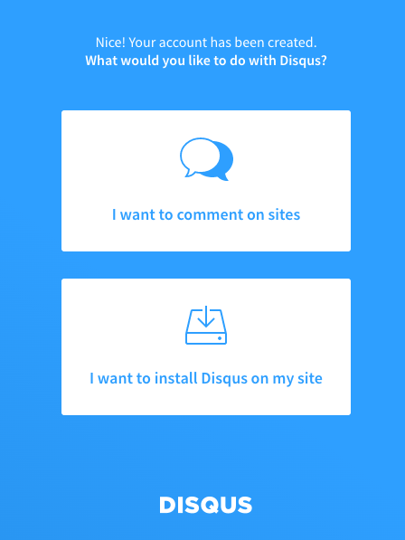
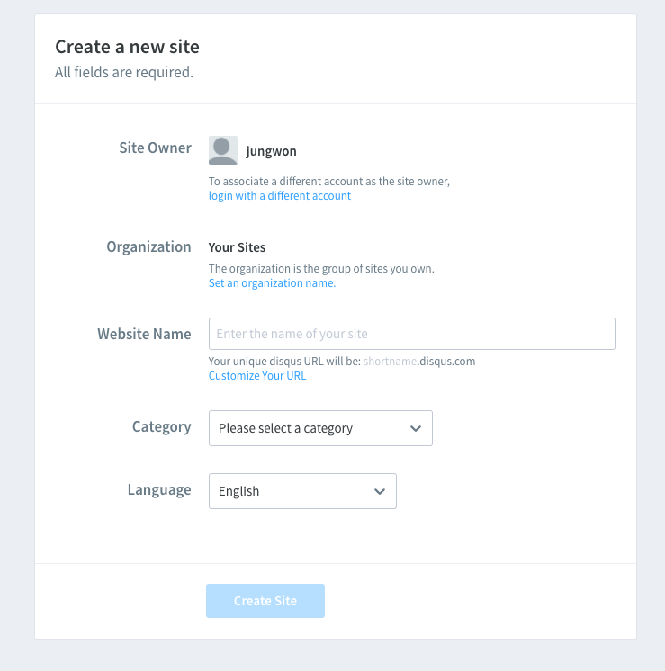
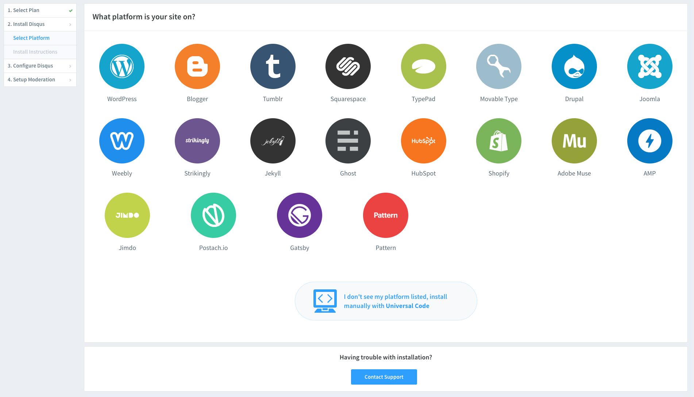
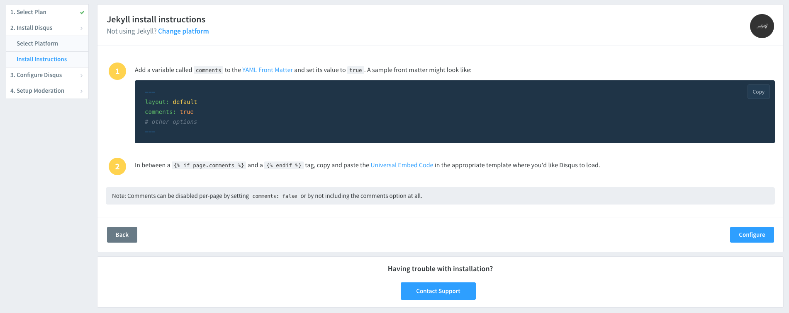
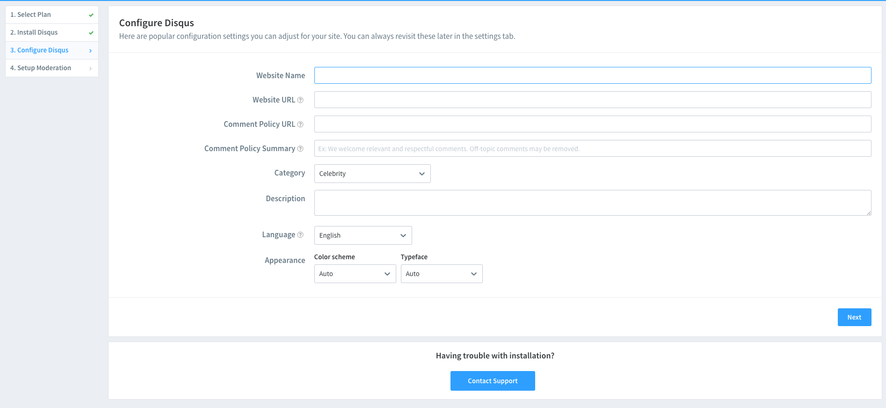
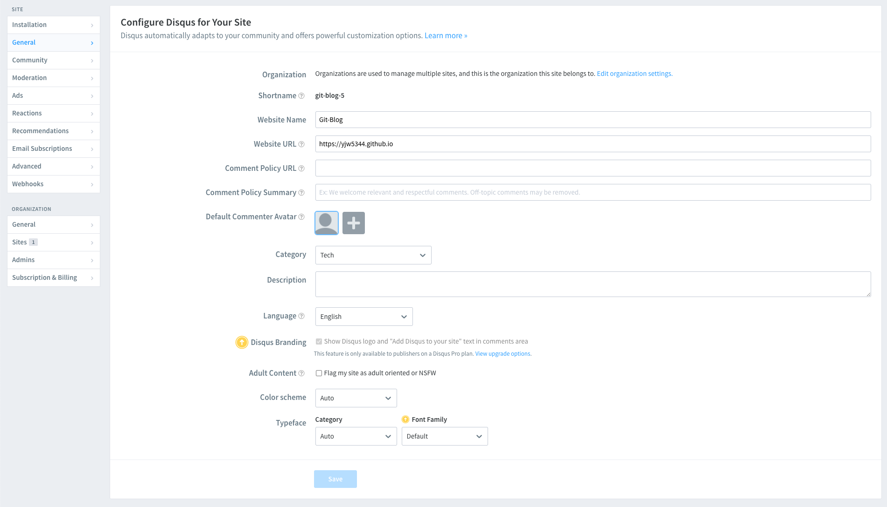

 

# Disqus 설정하기

 

Disqus를 사용해서 포스팅한 글에 댓글 기능을 추가할 수 있습니다.

`_config.yml` 설정 파일을 통해서 disqus 기능을 추가할 수 있습니다.

`_config.yml` 파일의 comments의 provider, disqus -> shortname, posts의 comments 설정을 변경해줘야 됩니다.

~~~

...

comments: #provider, shortname 수정 필요
  provider               : disqus # false (default), "disqus", "discourse", "facebook", "staticman", "staticman_v2", "utterances", "giscus", "custom"
  disqus:
    shortname            : git-blog-5 # https://help.disqus.com/customer/portal/articles/466208-what-s-a-shortname-
  discourse:
    server               : # https://meta.discourse.org/t/embedding-discourse-comments-via-javascript/31963 , e.g.: meta.discourse.org
  facebook:
    # https://developers.facebook.com/docs/plugins/comments
    appid                :
    num_posts            : # 5 (default)
    colorscheme          : # "light" (default), "dark"

...

# Defaults
defaults:
  # _posts
  - scope:
      path: ""
      type: posts
    values:
      layout: single
      author_profile: true
      read_time: true
      comments: true # true  # comments를 true로 변경 필요
      share: false #true => (default)
      related: true

~~~

 

## Disqus 사용하기

[https://disqus.com/](https://disqus.com/)에 접속하여 회원가입을 합니다.

회원가입 완료 후, `Get Started` 클릭하면 하단에 있는 이미지를 확인 할 수 있습니다.

"I want to comment on sites" 클릭

 

Website Name 입력합니다. 

입력하는 이름이 나중에 뒤에서 사용할 shortName 값이 됩니다.

 

다음으로 Plan은 Basic으로 선택하고, Platform은 Jekyll을 선택합니다.

 

Jekyll에서 install 가이드를 확인할 수 있고, Confiqure 버튼을 누릅니다.

 

Website URL에서 자신의 블로그 URL 주소를 입력합니다.

 

추가 정보를 입력하여, Disqus 생성을 완료합니다.

 

생성한 Disqus의 Shortname을 `_config.yml` 파일의 shortname에 입력해주면 됩니다.

