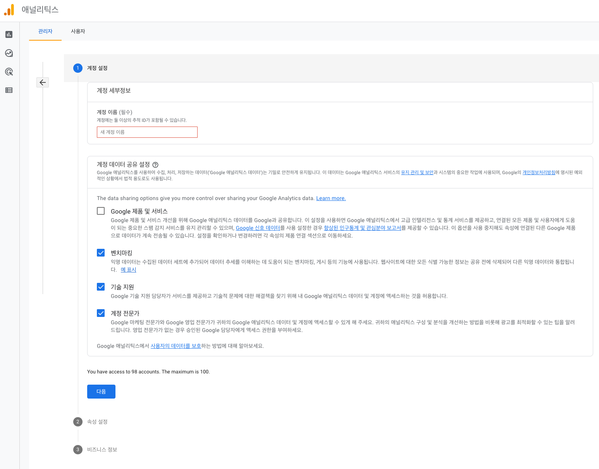
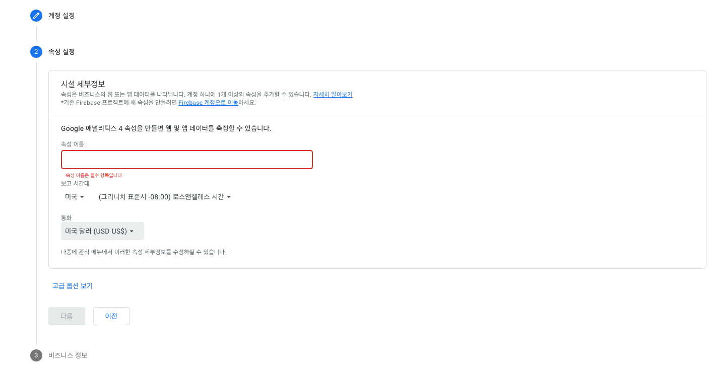
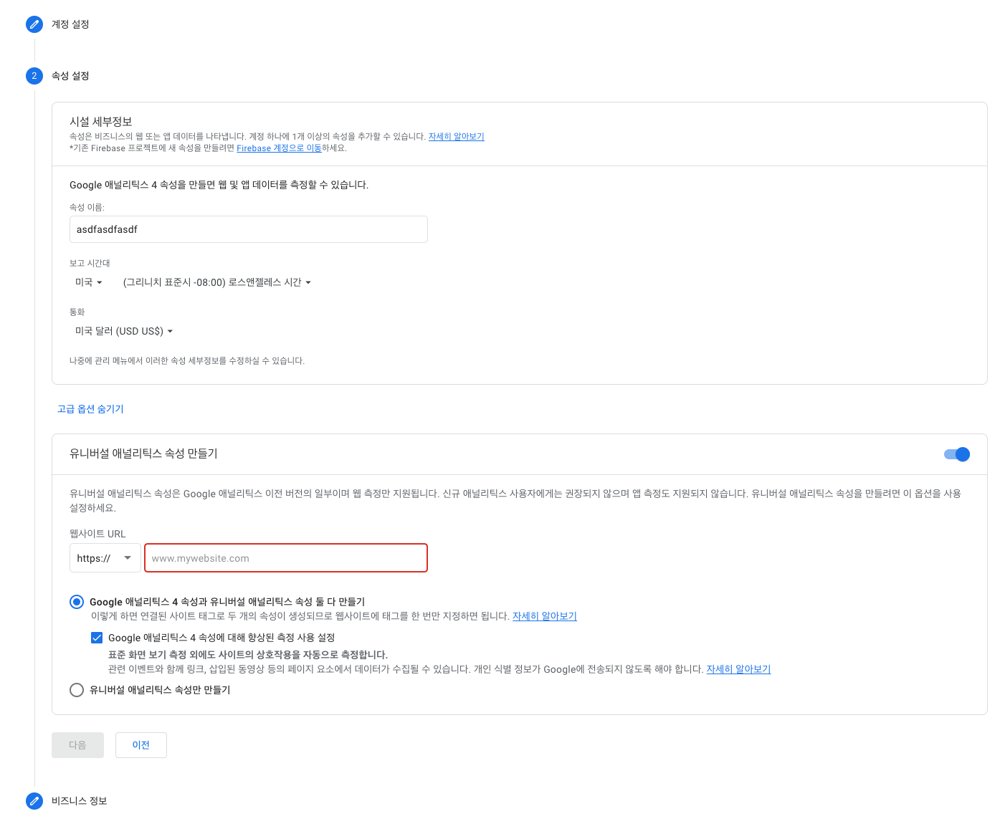
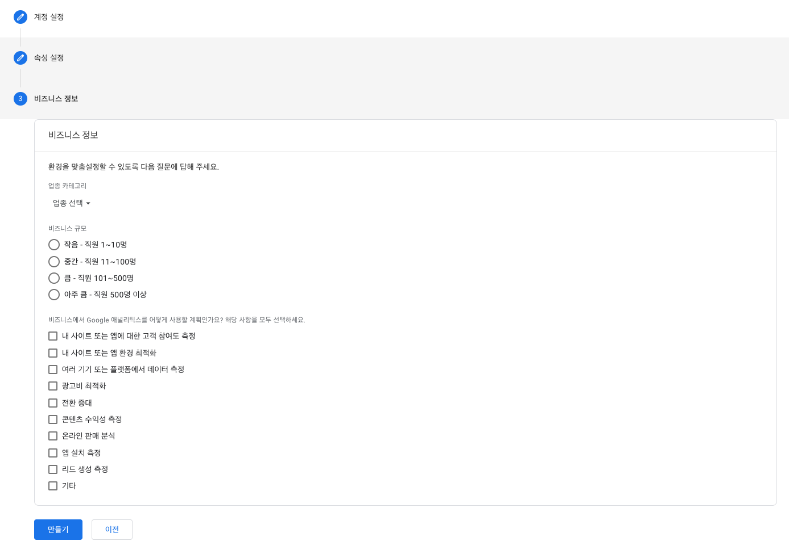
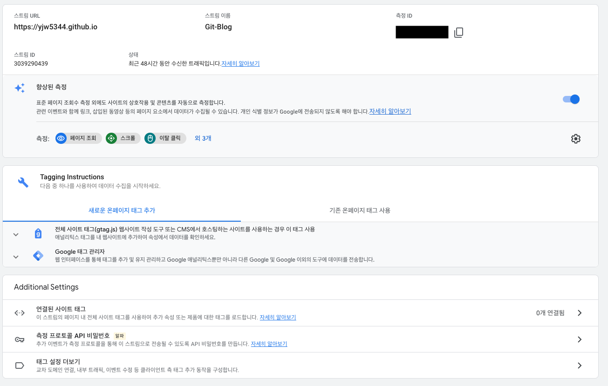

 

# Google analytics(GA) 설정하기

 

[Google Analytics](https://analytics.google.com/)에 접속하여 계정을 로그인합니다.

Jekyll 블로그에서 사용하기 위한 GA 계정을 신규(계정 만들기)로 생성합니다.

 

GA 계정 이름을 설정합니다.

 

속성 이름을 설정합니다. 속성은 사이트를 관리하는 하나의 단위로 보면 됩니다.

 

고급 옵션을 눌러 GA를 사용할 웹사이트 URL을 입력합니다.

자신의 블로그 주소 URL을 입력하면 됩니다.

 

블로그 정보에 맞는 비즈니스 정보를 입력하여 생성을 완료합니다.

 

## 웹 스트림 설정

관리자 페이지의 데이터 스트림 영역을 확인합니다.

입력한 웹사이트 URL을 측정하기 위해 부여 받은 측정ID를 복사합니다.

위에서 복사한 측정ID를 `_config.yml`파일의 Analytics 설정에 추가합니다.

provider -> google-gtag로 tracking_id는 측정ID로 입력을 설정을 완료합니다.

~~~

...

# Analytics
analytics:
  provider               : google-gtag # false (default), "google", "google-universal", "google-gtag", "custom"
  google:
    tracking_id          : # 측정 ID
    anonymize_ip         : # true, false (default)

...

~~~

Google Analytics 설정을 통해 방문계 통계 확인이 가능합니다.

GA의 자세한 기능은 따로 찾아보시면 됩니다.
